# Architecture overview

The test store as of 21 October 2026: what runs, where, how a commit reaches Railway, and what the roadmap still adds. Sources: [the Railway runbook](../runbooks/railway.md), [ADR 0005](../adr/0005-medusa-as-commerce-platform.md), [ADR 0006](../adr/0006-railway-hosts-the-test-store.md), [containers](containers.md), `.github/workflows/ci.yml`, `compose.yaml`, `apps/backend/medusa-config.ts`, the [core roadmap](../research/top-1-percent-ai-agent-engineer-roadmap.md) and the Setup 2 issues under [#3](https://github.com/Tirso0882/goods/issues/3).

## How to read this

- The diagrams go from the outside in: who talks to the store, how Railway hosts it, how a commit gets there, what one request does, how the same images run on a laptop, and what is still planned.
- Every flowchart uses the same shapes:

  | Shape | Kind of thing | Example |
  | --- | --- | --- |
  | `(( ))` circle | Person | Shopper, store admin |
  | `[ ]` rectangle | Service or process we run | `medusa-server`, CI job |
  | `[( )]` cylinder | Datastore | Postgres, Redis, R2 bucket |
  | `[[ ]]` double-sided box | External SaaS or platform | Stripe, GHCR, Railway API |

- Arrow labels say what flows, then the protocol: **HTTPS** (public internet, TLS), **private HTTP** (inside Railway's `*.railway.internal` network or a Compose network), **Postgres**, **Redis**, **webhook** (HTTPS POST started by a SaaS).
- Dashed lines and boxes are **planned**; solid ones run today.
- Sequence diagrams use stick figures for people and plain boxes for everything else, with the kind in brackets in the name.

## 1. System context

Who and what the test store talks to today. Shoppers and the admin reach Railway over HTTPS; Stripe calls back with webhooks; product uploads go to a Cloudflare R2 bucket; GitHub builds the images that Railway deploys. The developer laptop reaches the private databases only through `railway ssh` or `railway connect`.

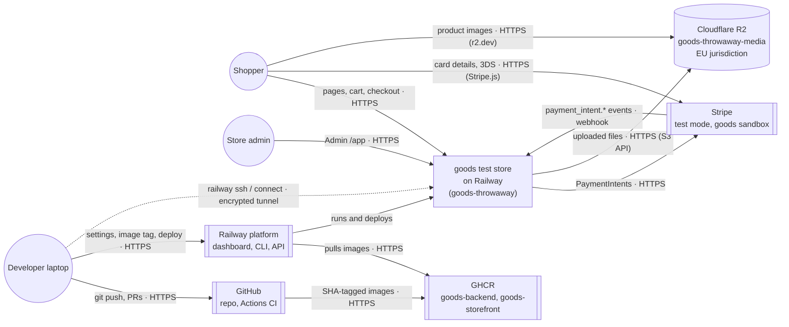

Legend: circles are people, rectangles are services we run, cylinders are datastores, double-sided boxes are external platforms. The dotted laptop arrow is an operator tunnel, not a public route.

## 2. Deployment on Railway

The `goods-throwaway` project in EU West (Amsterdam), environment `production`. Only `medusa-server` and `storefront` have public domains; everything else is reached on `*.railway.internal`. Postgres and Redis keep data on volumes and have no TCP proxy. The server migrates in a pre-deploy container before each release, and Railway switches traffic only after the health check passes.

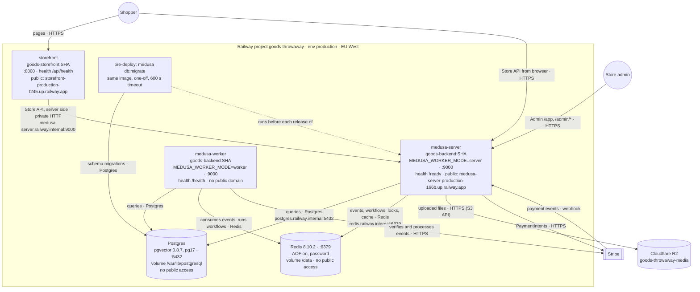

Legend: rectangles are Railway services we deploy, cylinders are datastores (the two inside the box are Railway services with volumes, R2 is outside Railway), the double-sided box is external SaaS. The dotted arrow means "runs before", not a data flow. Port 9000 on the worker serves only Railway's health check.

## 3. Build and release pipeline

A push to `main` runs five required CI jobs, then the `publish` matrix pushes both images to GHCR tagged with the full commit SHA and attests their provenance. The `deploy` job then points the Railway services at that SHA through Railway's public API, server first, and waits for each deployment to succeed before the next ([#17](https://github.com/Tirso0882/goods/issues/17), [deploy and rollback runbook](../runbooks/deploy-and-rollback.md)). Rollback is the same workflow run by hand with an older SHA.

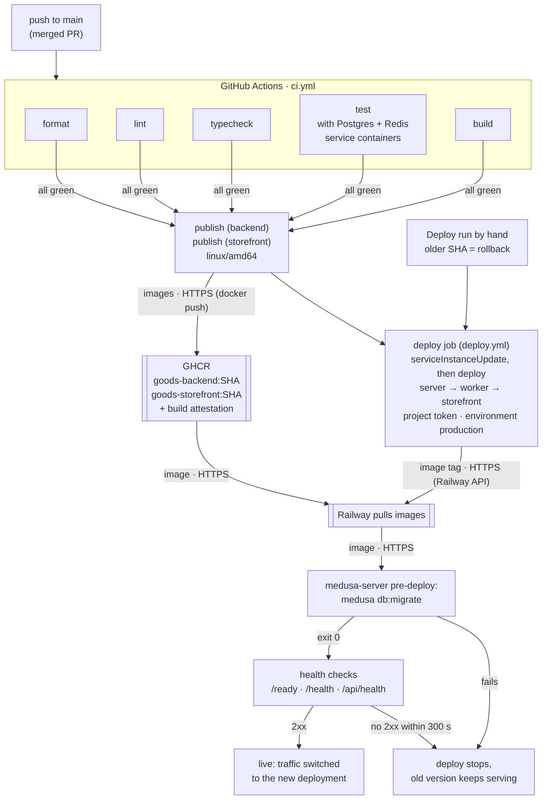

Legend: rectangles are pipeline steps, double-sided boxes are external platforms. Pull request runs stop after `build`: `publish` only runs on `main`.

## 4. Runtime request flows

### 4a. A shopper opens /pl

The page is a React Server Component, so the browser only talks to the storefront. The storefront's server calls the Store API over the private network with the publishable key; Medusa reads the catalog from Postgres and uses Redis for its cache. Product images load straight from their URL.

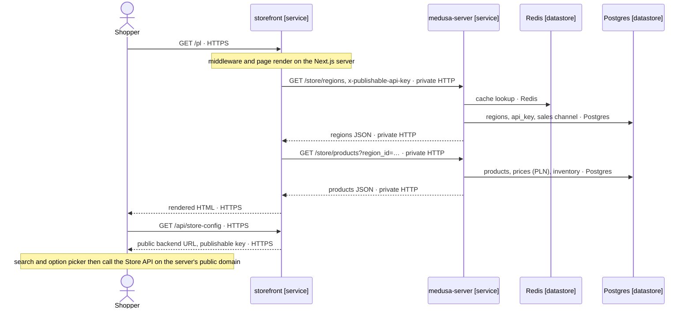

Legend: stick figure is a person; `[service]` and `[datastore]` mark the kind of each box. Solid arrows are requests, dashed arrows are responses.

### 4b. A Stripe test checkout

Cart and payment-session calls go through the storefront's server actions to the Store API, which creates a PaymentIntent at Stripe. The browser confirms the card with Stripe.js and returns to `/api/payment-return`, which completes the cart. Independently, Stripe posts a webhook to the server, which acknowledges it and queues `payment.webhook_received` in Redis; the worker verifies the signature and processes it, so the order exists even if the shopper closes the tab.

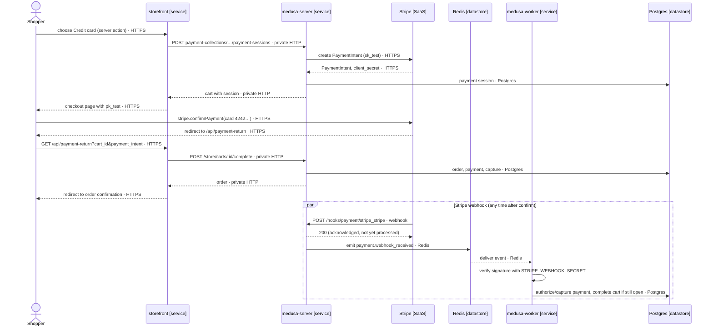

Legend: as in 4a. The `par` block runs alongside the redirect path; whichever arrives second finds the cart already completed and changes nothing ([duplicate delivery is verified](../verification/stripe-failure-paths.md)).

## 5. Local environments

Two ways to run the store on a laptop. `pnpm dev` runs Medusa in shared mode (one process for HTTP and jobs) and Next.js from source, against Postgres and Redis in Docker. The Compose stack runs the same images CI publishes, with the same server/worker split and one-off migrate as Railway; set `BACKEND_IMAGE` and `STOREFRONT_IMAGE` to a GHCR SHA tag to run exactly what is deployed.

### 5a. `pnpm dev`

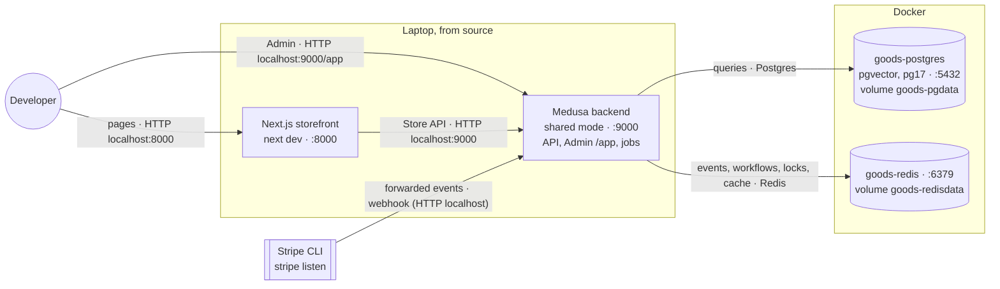

### 5b. Compose stack: long-running services (`compose.yaml`)

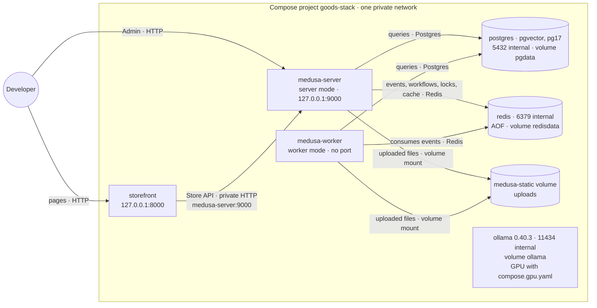

### 5c. Compose stack: one-off containers

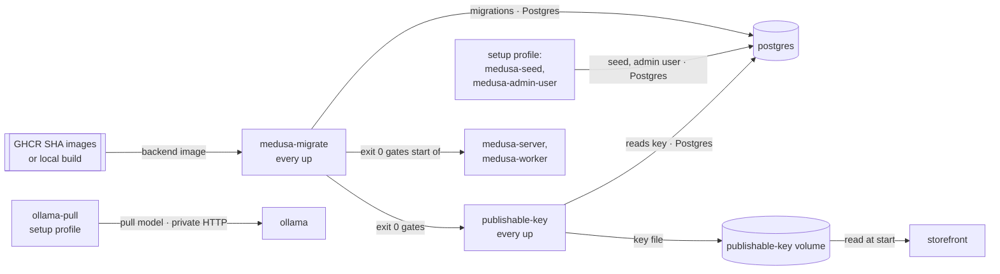

Legend for 5a to 5c: as in diagram 1. In 5c, "gates" arrows are start order (`depends_on: service_completed_successfully`), not data. In Compose nothing calls Ollama yet: it waits for the agent. Without `S3_BUCKET`, server and worker share uploads on the `medusa-static` volume instead of R2.

| | `pnpm dev` | Compose | Railway |
| --- | --- | --- | --- |
| Backend | source, shared mode | `goods-backend` image, server + worker | `goods-backend:<sha>`, server + worker |
| Storefront | `next dev` | `goods-storefront` image | `goods-storefront:<sha>` |
| Migrations | `pnpm medusa db:migrate` by hand | `medusa-migrate` one-off on every `up` | server pre-deploy command |
| Files | local provider | `medusa-static` volume | R2 bucket |
| Stripe webhook | `stripe listen` | `stripe listen` | Stripe Dashboard endpoint |

## 6. Target architecture

What the roadmap adds to diagram 2. A Python agent service (FastAPI, LangGraph, LiteLLM) joins the project on the private network; it changes store data only through Medusa's APIs ([ADR 0005](../adr/0005-medusa-as-commerce-platform.md)), keeps its own tables in a separate Postgres schema, and searches FAQ and policy documents with pgvector. A nightly cron writes encrypted `pg_dump` backups to a separate R2 bucket ([#19](https://github.com/Tirso0882/goods/issues/19)), and the whole project is rebuilt from the runbook as the real one ([#18](https://github.com/Tirso0882/goods/issues/18)).

### 6a. The support agent on Railway

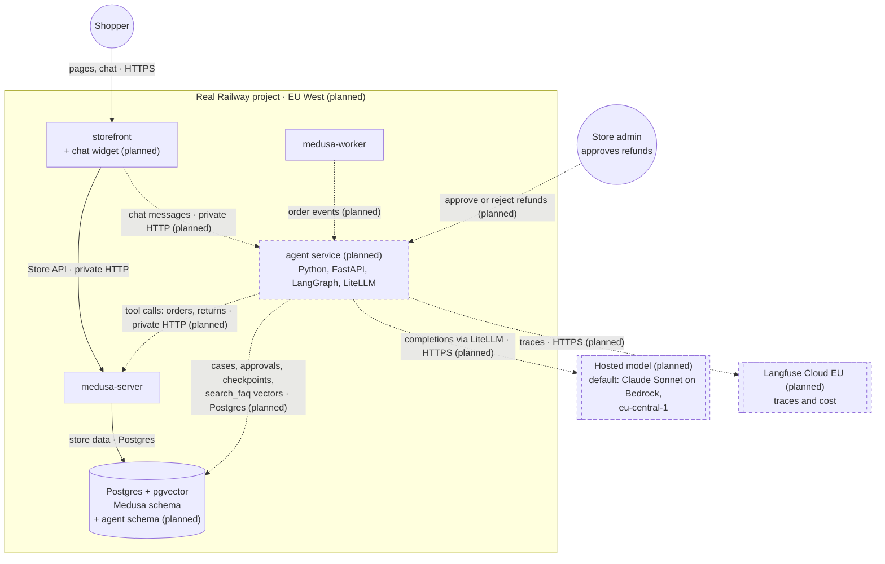

Legend: shapes as in diagram 1; dashed outlines and arrows are planned. Redis, Stripe and R2 are left out here: nothing about them changes for the agent.

### 6b. Backups, monitoring and the real project

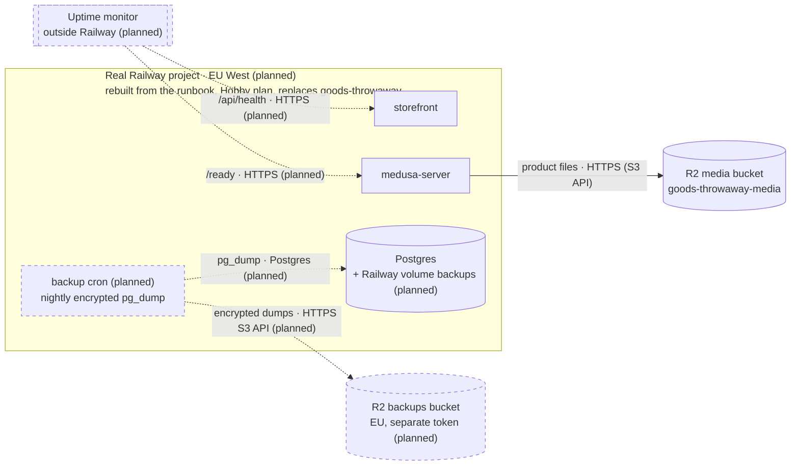

Legend: shapes as in diagram 1; dashed means planned. Media and backups use separate buckets, so a credential leaked from the store can't touch the backups (ADR 0006). The restore drill in #19 restores into an isolated environment, which is not drawn.

### 6c. Agent model routing: local and hosted

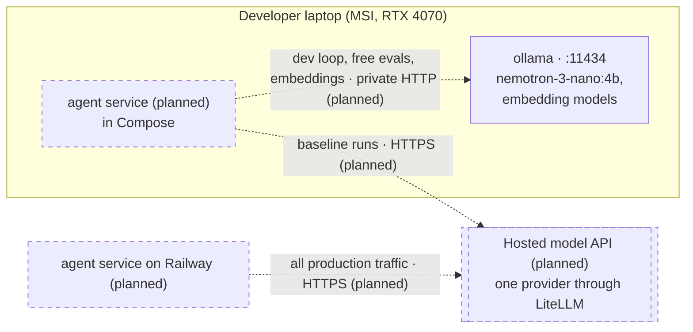

Legend: shapes as in diagram 1; dashed means planned. Ollama itself already runs in Compose (solid). Production has no GPU, so Ollama never runs on Railway.

## Assumptions

- **Stripe webhook on Railway.** The runbook does not yet record the deployed webhook endpoint; [#16](https://github.com/Tirso0882/goods/issues/16) requires one at the public HTTPS URL. Diagrams 2 and 4b assume it uses the same route as locally, `/hooks/payment/stripe_stripe` on `medusa-server`.
- **Webhook processing in 4b.** The server-acknowledges, worker-processes split is from the runbook ("the Stripe webhooks the server queues") and the local verification; the exact Medusa calls the worker makes after verifying are summarized, not traced.
- **Redis in 4a.** Medusa's Redis caching module is configured, but which Store API reads hit the cache was not measured; the arrow shows the configured path.
- **Private host names.** `postgres.railway.internal` and `redis.railway.internal` follow Railway's naming from the service names; the runbook only says the URLs use `${{RAILWAY_PRIVATE_DOMAIN}}`.
- **Store API calls from the browser.** The runbook says browsers call the Store API on the server's public domain for search and the option picker; other cart calls go through storefront server actions (`apps/storefront/src/lib/data/cart.ts`).
- **Chat path in 6a.** The roadmap shows "storefront → agent (chat widget)" but not whether the browser or the storefront server calls the agent, or whether the agent gets a public domain. The diagram assumes the storefront server calls it over the private network, keeping the agent private like the worker.
- **Order events to the agent.** The roadmap shows "order events" from Medusa to the agent without a transport; the diagram draws them from the worker, which runs subscribers.
- **Agent data placement.** The roadmap puts agent tables in a separate schema of the same Postgres; diagram 6a draws one database with two schemas, not a second Postgres service.
- **Hosted model.** Claude Sonnet on Amazon Bedrock (`eu-central-1`) is the roadmap's default, not a recorded decision; the "Hosted model provider" field is still open.
- **Backup cron and plan.** The backup cron is a sixth service, so ADR 0006 requires upgrading to Hobby first; R2 config and Railway config backups from #19 are not drawn.
